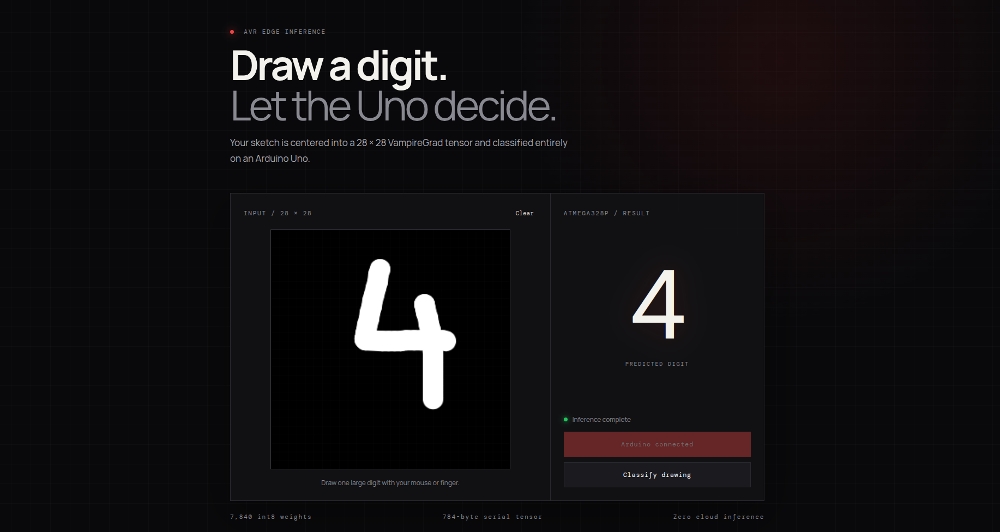

# VampireGrad MNIST on Arduino Uno

This project trains a 10-class MNIST linear classifier on a desktop, quantizes it to int8, stores its 7,840 weights in AVR flash, and performs inference on an ATmega328P. A browser canvas preprocesses a drawing into a flat 28 × 28 tensor and sends its 784 bytes to the board through Web Serial.

The included trained model reaches **92.00% float accuracy** and **91.98% int8 accuracy** on the 10,000-image MNIST test set.

## 1. Train and export

Create a Python environment and install the sole dependency:

	python3 -m venv .venv
	.venv/bin/pip install -r requirements.txt

Train and regenerate `model_data.h`:

	.venv/bin/python tools/train_mnist.py

The script downloads the official IDX dataset into `.cache/mnist`, validates its headers, normalizes each image, and flattens it into a row-major VampireGrad `Tensor` with shape `[samples, 784]`. It trains softmax regression with minibatch gradient descent, measures both float and quantized accuracy, and emits an AVR `PROGMEM` header.

Useful options include `--epochs`, `--batch-size`, `--learning-rate`, `--seed`, `--cache`, and `--output`.

## 2. Build and upload

Connect the Uno and run:

	./run.sh

The firmware validates that the model is int8 with input shape `[784]` and output shape `[10]`. It keeps the image in SRAM, reads weights directly from flash, computes ten int32 dot products, and returns the argmax digit.

Current ATmega328P usage with the installed AVR toolchain:

- Program flash: **12,006 bytes (36.6%)**
- Static SRAM: **872 bytes (42.6%)**

## 3. Open the canvas

Serve the frontend from localhost (Web Serial requires a secure context):

	.venv/bin/python -m http.server 8000 -d web

Open `http://localhost:8000` in desktop Chrome or Edge, select **Connect Arduino**, draw one large digit, and select **Classify drawing**. Close serial monitors such as `picocom` first because only one program can own the serial port.

The browser crops the drawing, scales its longest edge to 20 pixels, centers it in a 28 × 28 black image, flattens the grayscale pixels, and transmits the resulting uint8 tensor at 57,600 baud.

## Serial protocol

Each request is binary and has a fixed size:

1. Magic bytes `0x56 0x47` (`VG`)
2. 784 row-major uint8 pixels
3. One modulo-256 checksum over the pixels

Responses are newline-terminated ASCII:

- `READY` — firmware initialized
- `P:7` — predicted digit 7
- `E:checksum`, `E:model`, `E:shape`, or `E:inference` — error

## Inference library and model format

`tinyinfer.h` exposes both the original float32 dense path and `tinyinfer_predict_u8()` for a single quantized dense layer. Both paths are heap-free.

Version 1 models start with a 16-byte `VGRD` header and an 8-byte dense-layer header. The int8 payload contains a float32 quantization scale, output-major int8 weights, and int32 biases. The scale is retained for host tooling; AVR classification compares raw int32 scores, so it performs no floating-point work.

The older C++ autograd and linear-regression example remains under `tinygrad/`. Its build helper now exports `linear_model_data.h` by default so it does not overwrite the MNIST model.
